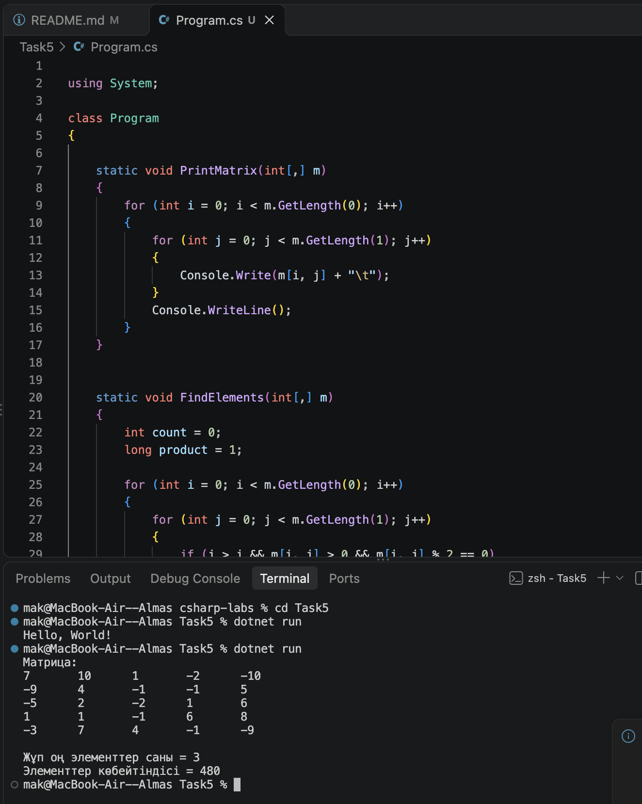

# 5-тапсырма: Екі өлшемді массивтер (1-нұсқа)

## Тест нәтижелері

| Тест | Кіріс | Қолмен есептеген жауап | Бағдарлама жауабы |
|---|---|---|---|
| Жеке тест | Random(4) | Саны = 3, көбейтіндісі = 480 | Саны = 3, көбейтіндісі = 480 |
| Өз тестім 1 | Барлық элементі 1 | Саны = 0, элемент жоқ | Саны = 0, элемент жоқ |
| Өз тестім 2 | Барлық элементі 2 | Саны = 10, көбейтіндісі = 1024 | Саны = 10, көбейтіндісі = 1024 |

## Сұрақтарға жауап

1. matrix[i, j] жазбасында i — жол нөмірі, j — баған нөмірі. GetLength(0) жол санын, GetLength(1) баған санын қайтарады.

2. Бас диагональдан жоғары элементтерді таңдау үшін j > i шартын қолдандым. Бас диагональдың өзі бұл шартқа кірмейді, себебі онда i = j болады.

3. Ішкі цикл әр жол үшін 5 рет орындалады. Барлығы 5 × 5 = 25 рет орындалады.

## ЖИ қолдану

ЖИ-ден матрицадағы бас диагональдан жоғары орналасқан жұп оң элементтерді табу алгоритмін түсіндіруді сұрадым. Ұсынылған кодты өз жобама енгізіп, іске қосып тексердім.s
