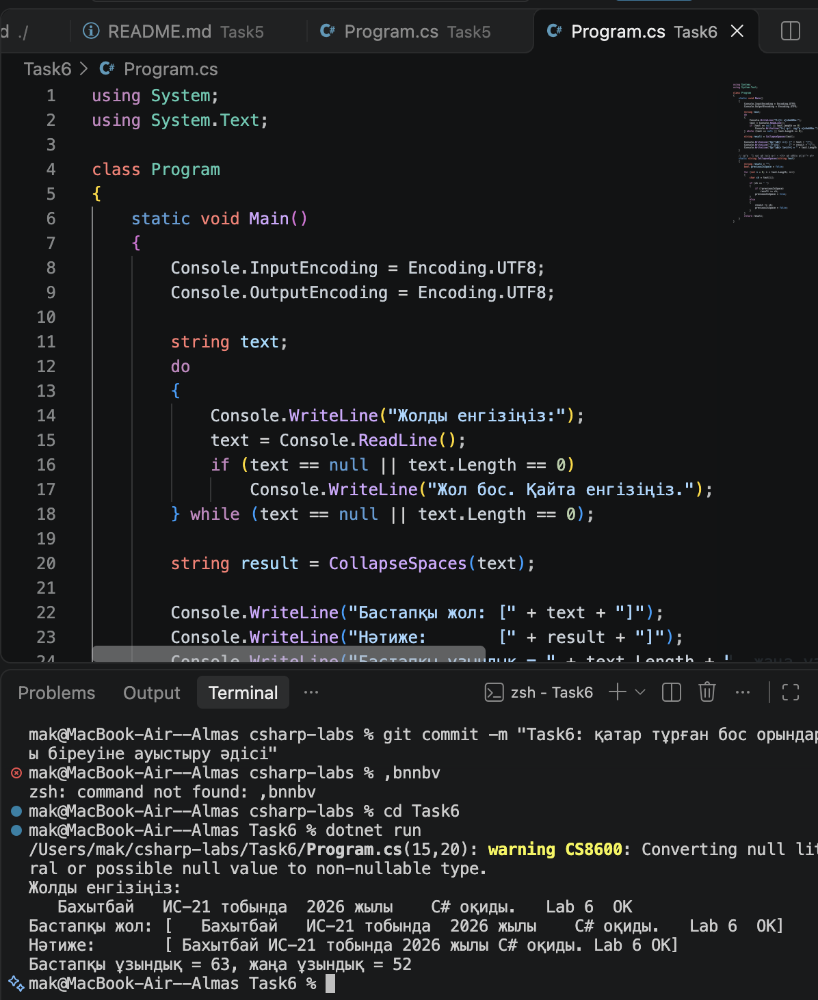

# 6-тапсырма: Символдар тіркесі (нұсқа 3)



| Тест | Кіріс | Қолмен есептеген жауап | Бағдарлама жауабы |
|---|---|---|---|
| Жеке тест | `   Бахытбай   ИС-21 тобында  2026 жылы    C# оқиды.   Lab 6  ОК   ` | ` Бахытбай ИС-21 тобында 2026 жылы C# оқиды. Lab 6 ОК ` | ` Бахытбай ИС-21 тобында 2026 жылы C# оқиды. Lab 6 ОК ` |
| Өз тестім 1 | `a    b` | `a b` | `a b` |
| Өз тестім 2 | `abc` | `abc` | `abc` |

## Сұрақтарға жауап

1) `text[i]` жолдың i-ші орнындағы символды қайтарады, оның типі `char`. `text[i] = 'a';` деп жазуға болмайды, өйткені C#-та `string` өзгермейді: жол жасалғаннан кейін оның ішіндегі символды ауыстыра алмаймыз. Өзгерту керек болса, жаңа жол жасау керек.
2) Алдыңғы символ бос орын болғанын `previousIsSpace` деген `bool` айнымалысы есте сақтайды. Бос орын кездескенде, егер алдыңғы символ бос орын болмаса ғана оны жаңа жолға қосамын. Алдыңғысы да бос орын болса, өткізіп жіберемін. Бос орын емес символ кездессе, оны қосып, айнымалыны `false` етемін.
3) `result += ch;` орындалғанда жаңа жол жасалады, ескісі өзгермейді. `result` айнымалысы енді сол жаңа жолға сілтейді. Сондықтан ұзын жолдарда жады көп жұмсалады, ол үшін `StringBuilder` тиімдірек.

## Кездескен қате

Қате: жаңа `Task6` жобасын жасап, `dotnet run` жазғанда, күтілген «Жолды енгізіңіз:» орнына `Hello, World!` шықты.
Қалай түзеттім: `Task6/Program.cs` ішіндегі код ауыстырылмай, ескі шаблон қалған екен, сондықтан бағдарлама сол кодты іске қосты. Мен файлдағы мәтінді өз кодыммен толық ауыстырып, `Cmd+S` арқылы сақтадым да, қайта `dotnet run` жасадым, содан кейін дұрыс жұмыс істеді.
Түзеткен коммит: d5b22a9

## Git

`git log --oneline --graph --all` командасының нәтижесі:

```
* d20cf4d (HEAD -> task6) Task6: қатар тұрған бос орындарды біреуіне ауыстыру әдісі
* d5b22a9 Task6: жолды енгізу және do-while арқылы бос жолды тексеру
*   c94f6cb (origin/main, origin/HEAD, main) Merge pull request #2 from almasaday08-glitch/task5
|\  
| * d268bd4 (origin/task5, task5) Task5: есеп пен сұрақтарға жауап қосу
* | 7c89942 Merge pull request #1 from almasaday08-glitch/task5
|\| 
| * 7f5fea6 Task5: матрицаны толтыру және шығару
|/  
* da468a9 Мазмұн README және .gitignore қосылды
* 379f87d Initial commit
```

1) `task5` тармағын GitHub-та Pull Request арқылы `main`-ге біріктірдім (#1 және #2), сондықтан коммиттер `main` тарихына түсті. Біріктіруден кейін `task5` тармағы өшпей, GitHub-та қалды.
2) `commit` өзгерісті тек компьютердегі жергілікті репозиторийге сақтайды, ал `push` оларды GitHub-қа жібереді. Push жасамасам, мұғалім GitHub-та ештеңе көрмейді.
3) `.gitignore` файлына `dotnet new gitignore` командасы жасаған .NET үшін стандартты тізім жазылды. `bin/` және `obj/` құрастыру кезінде автоматты түрде жасалатын уақытша файлдар, оларды кодтан қайта алуға болады, сондықтан репозиторийге қосылмайды.